<div align="center">


<p>
<a href="https://www.linkedin.com/in/leonardo-pereira-pinheiro/"></a>
<a href="https://tryhackme.com/p/Cyberghost7"></a>
<a href="https://app.hackthebox.com/users/2929177"></a>
<a href="https://bugcrowd.com/Cyberghost2077"></a>
<a href="https://github.com/Leobatman"></a>
</p>
</div>
---
 
## 👻 About Me
 
<table>
<tr>
<td width="50%" valign="top">
**Leonardo Pereira Pinheiro** · *Cyber Ghost*
 
🎓 Computer Engineering — São Judas *(in progress)*<br>
🛡️ Cybersecurity Technician — SENAC São Paulo<br>
🎯 Road to **OSCP**
 
**🔴 Offense** — recon, web, AD, exploitation, privesc
 
**🔵 Defense** — SOC, threat hunting, DFIR, detection engineering
 
**🧬 Reverse** — malware analysis, binary exploitation, firmware
 
**🛰️ Goal** — space systems security: satellite links, ground stations and telemetry
 
📍 São Paulo, Brazil · 🇧🇷 PT / 🇺🇸 EN
 
</td>
<td width="50%" align="center">
<!-- 👇 GIF DO ABOUT ME: troque a URL abaixo -->

</td>
</tr>
</table>
I break systems in the lab to understand how attackers think, then build the detection and response to catch them. Every technique I study ends up as a lab, a write-up or a tool.
 
---
 
## 🚀 Featured Projects
 
<table>
<tr>
<td width="50%" valign="top">
### 🔍 [dntriage](https://github.com/Leobatman/dntriage)
Open source triage tool for **.NET malware**: detects obfuscators/packers (ConfuserEx), extracts IOCs and generates a quick analysis report.
 
`Python` `dnlib` `YARA`
 
</td>
<td width="50%" valign="top">
### 🤖 Ultron — Agente-Pentest
**Multi-AI Cyber SOC** platform with a neural dashboard that assists recon, enumeration and reporting during pentests.
 
`Python` `LLMs` `Docker`
 
</td>
</tr>
<tr>
<td width="50%" valign="top">
### 🧪 Purple Team Lab
Attack → telemetry → detection pipeline: AD, Linux and web targets monitored by Wazuh, Suricata and Sysmon.
 
`Active Directory` `Wazuh` `Sigma`
 
</td>
<td width="50%" valign="top">
### 🧬 Coming next
**Detection Tester** — validate detection rules against ATT&CK techniques.
**BR Threat Intel** — feed focused on threats targeting Brazil.
 
`Sigma` `ATT&CK` `MISP` `OpenCTI`
 
</td>
</tr>
</table>
---
 
## 🛠️ Arsenal
 
### 🔴 Offensive Security
 
<table>
<tr><td width="190"><b>Recon & OSINT</b></td><td>              </td></tr>
<tr><td width="190"><b>Web AppSec</b></td><td>            </td></tr>
<tr><td width="190"><b>Active Directory</b></td><td>          </td></tr>
<tr><td width="190"><b>Exploitation & C2</b></td><td>     </td></tr>
<tr><td width="190"><b>Pivoting & PrivEsc</b></td><td>        </td></tr>
<tr><td width="190"><b>Password Attacks</b></td><td>    </td></tr>
<tr><td width="190"><b>Wireless & RF</b></td><td>      </td></tr>
</table>
### 🔵 Defensive Security & DFIR
 
<table>
<tr><td width="190"><b>SIEM / XDR</b></td><td>    </td></tr>
<tr><td width="190"><b>Network</b></td><td>      </td></tr>
<tr><td width="190"><b>Endpoint & Hunting</b></td><td>    </td></tr>
<tr><td width="190"><b>Detection Eng.</b></td><td>   </td></tr>
<tr><td width="190"><b>Forensics</b></td><td>         </td></tr>
<tr><td width="190"><b>Threat Intel & IR</b></td><td>     </td></tr>
</table>
### 🧬 Reverse Engineering, Malware & Pwn
 
<table>
<tr><td width="190"><b>Disassemblers</b></td><td>     </td></tr>
<tr><td width="190"><b>Debuggers</b></td><td>    </td></tr>
<tr><td width="190"><b>.NET & Java</b></td><td>   </td></tr>
<tr><td width="190"><b>Malware Analysis</b></td><td>         </td></tr>
<tr><td width="190"><b>Pwn / Exploit Dev</b></td><td>      </td></tr>
<tr><td width="190"><b>Firmware / Embedded</b></td><td>    </td></tr>
<tr><td width="190"><b>CTF Misc / Crypto</b></td><td>     </td></tr>
</table>
### ⚙️ Infrastructure & Cloud
 
<table>
<tr><td width="190"><b>Operating Systems</b></td><td>      </td></tr>
<tr><td width="190"><b>Virtualization</b></td><td>    </td></tr>
<tr><td width="190"><b>IaC & Cloud</b></td><td>    </td></tr>
<tr><td width="190"><b>Cloud / Code Security</b></td><td>      </td></tr>
</table>
### 🧑‍💻 Programming & Workflow
 
<table>
<tr><td width="190"><b>Languages</b></td><td>         </td></tr>
<tr><td width="190"><b>Editors & Tools</b></td><td>      </td></tr>
</table>
<div align="center">
<br>

</div>
---
 
## 🐞 Bug Bounty & Vulnerability Disclosure
 
```text
Platforms : Bugcrowd (Cyberghost2077) • HackerOne
Programs  : Private & public programs • NASA VDP
Focus     : Broken Access Control (IDOR / BOLA) • Business Logic • Source Code Review
Status    : Valid vulnerability reported on a fintech program
```
 
---
 
## 🧪 Security Lab — Purple Team Pipeline
 
```text
 ┌─────────────────────┐      ┌──────────────────────────┐      ┌──────────────────────────┐
 │      RED TEAM       │      │    TARGET ENVIRONMENT    │      │        BLUE TEAM         │
 │                     │      │                          │ logs │                          │
 │ Recon • Exploit     │────▶ │ AD Forest • Linux • Web  │────▶ │ Wazuh • Suricata • Zeek  │
 │ PrivEsc • Lateral   │      │ Internal services        │      │ Sysmon • Sigma rules     │
 │ Sliver / Havoc C2   │      │ Vulnerable apps          │      │ Hunting • IR • Reports   │
 └─────────────────────┘      └──────────────────────────┘      └────────────┬─────────────┘
                                           ▲                                 │
                                           └──────── tune detections ◀───────┘
```
 
---
 
## 🏁 Training & Certifications
 
| Status | Item |
|:---:|---|
| 🎯 | **OSCP** — Offensive Security Certified Professional *(in progress)* |
| ✅ | **Cybersecurity Technician** — SENAC São Paulo |
| 🎓 | **B.Eng. Computer Engineering** — Universidade São Judas Tadeu *(in progress)* |
| 🚩 | **CTF** — Web, Reverse, Pwn, Forensics, Crypto, OSINT |
| 🧠 | **TryHackMe** & **Hack The Box** learning paths |
 
<div align="center">
<a href="https://tryhackme.com/p/Cyberghost7"></a>
</div>
 
---
 
## 🛰️ Aerospace & Embedded Security
 
<table>
<tr>
<td width="50%" align="center">
<!-- 👇 GIF DA NASA: troque a URL abaixo se quiser outro -->

<br><sub>🛰️ via NASA on GIPHY</sub>
</td>
<td width="50%" valign="top">
**📡 Software-Defined Radio**
RF fundamentals, telemetry analysis, signal processing and communication security.
 
**🔒 Embedded & Firmware**
Firmware RE, microcontroller security, secure boot, low-level vulnerability research.
 
**🛰️ Space Systems**
Satellite link security, ground station hardening and telemetry protection — mapped with the **SPARTA** framework.
 
`RTL-SDR` `GNU Radio` `SDR++` `GQRX`
 
</td>
</tr>
</table>
```text
[ MISSION TARGET ]  ground station ──uplink──▶ 🛰️ satellite ──downlink──▶ telemetry
[ THREATS        ]  jamming • spoofing • replay • command injection • firmware tampering
[ OBJECTIVE      ]  secure the link, the ground segment and the spacecraft software
```
 
---
 
## 📊 Operational Telemetry
 
<div align="center">

<br><br>
 

<br>
<picture>
  <source media="(prefers-color-scheme: dark)" srcset="https://raw.githubusercontent.com/Leobatman/Leobatman/output/pacman-contribution-graph-dark.svg">
  <source media="(prefers-color-scheme: light)" srcset="https://raw.githubusercontent.com/Leobatman/Leobatman/output/pacman-contribution-graph.svg">
  
</picture>
</div>
---
 
<div align="center">
> *"In cybersecurity, understanding the attack is essential to building effective defense."*
 


</div>
 
